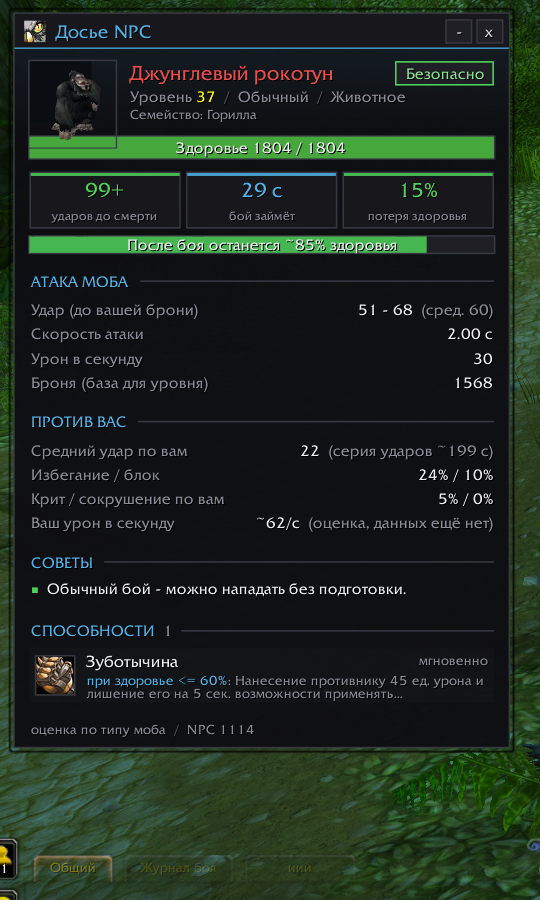

# NPC Info — досье мобов для WoW 3.3.5a

Аддон для World of Warcraft: Wrath of the Lich King (3.3.5a). Показывает подробное досье на любого NPC: здоровье, урон, скорость атаки, способности и то, насколько моб опасен **именно для вашего персонажа**. Работает для любого класса.

## Возможности

- **Досье NPC** — отдельное окно с информацией о цели:
  - здоровье, ресурс, уровень, классификация, тип и семейство;
  - 3D-портрет моба (если модель не загрузилась — обычный портрет);
  - сводка: сколько ударов вы выдержите, сколько займёт бой и сколько здоровья вы потеряете;
  - атака моба: разброс удара, скорость атаки, урон в секунду, броня;
  - против вас: средний удар с учётом вашей брони, избегание и блок, шанс крита и сокрушения, ваш урон в секунду;
  - советы с учётом **изученных** способностей вашего класса и питомца (прерывания, снятие страха и оглушения, замедления, снятие ядов, болезней и проклятий);
  - особенности: убегает за помощью, зовёт помощь, заклинатель, лечится, урон по области и т. д.;
  - способности моба с иконками, временем подготовки, школой магии и условиями применения.
- **Оценка опасности**: «Безопасно», «Опасно» или «Смертельно». Считается по таблице атаки 3.3.5 против вашей брони, Защиты, уклонения, парирования и блока.
- **Блок в подсказке** враждебного NPC; подробности — по Shift, Ctrl, Alt или всегда.
- **Кнопка у портрета цели**: цвет рамки показывает уровень опасности.
- **Пункт «Досье NPC»** в меню ПКМ по рамке цели или фокуса.
- **Калибровка**: прогноз урона уточняется по журналу боя (общая для всех персонажей аккаунта).
- **Учёт вашего урона в секунду** по реальным боям (вы и питомец).
- Свёрнутый режим, окно следует за сменой цели, позиция окна сохраняется.

Данные об уроне и способностях мобов взяты из открытой базы [AzerothCore](https://www.azerothcore.org/) 3.3.5a.

## Установка

1. Скачайте `NPCInfo-x.y.z.zip` из раздела [Releases](../../releases) (не «Source code»).
2. Распакуйте в `World of Warcraft\Interface\AddOns\` так, чтобы получилось `Interface\AddOns\NPCInfo\NPCInfo.toc`.
3. Перезапустите игру и включите аддон в списке модификаций.

При обновлении сначала удалите старую папку `NPCInfo`.

## Команды

| Команда | Действие |
| --- | --- |
| `/npci` или `/npcinfo` | Открыть досье текущей цели |
| `/npci config` | Настройки |
| `/npci on` / `/npci off` | Включить / выключить аддон |
| `/npci minimap` | Показать / скрыть кнопку у миникарты |
| `/npci stats` | Статистика калибровки и вашего урона |
| `/npci reset calib` / `/npci reset dps` | Сбросить калибровку / данные об уроне |

## Совместимость

- Клиент: 3.3.5a (Interface 30300).
- Язык интерфейса: русский.
- Оценки приблизительные: реальный урон на конкретном сервере может отличаться. Калибровка по журналу боя постепенно уточняет прогноз.

## Лицензия

GPL-2.0-or-later — см. [LICENSE.txt](LICENSE.txt).
